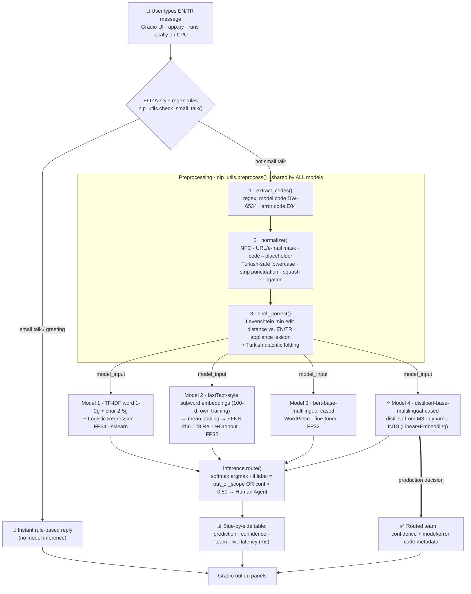
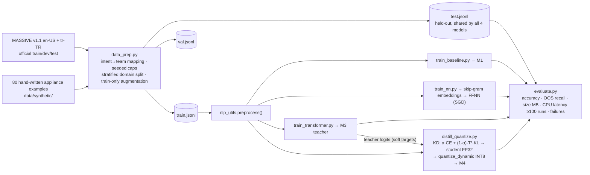

# Architecture, Technique Map & Slide Outline

Everything below matches the code in this repository. Function names are given as `file → function`.

---

## 1. System architecture (R6)

### 1a. Runtime / inference flow (`app.py`, the same path as `src/evaluate.py`)



### 1b. Training / offline flow



### 1c. ASCII version (for plain-text slides)

```
                     ┌──────────────────────── Gradio UI (app.py, local CPU) ────────────────────────┐
 user message ──────►│ check_small_talk()  ──yes──► ELIZA reply (no model)                           │
  (EN / TR)          │        │ no                                                                   │
                     │        ▼                                                                      │
                     │ preprocess(): extract_codes → normalize → spell_correct (Levenshtein)          │
                     │        │ model_input                                                          │
                     │   ┌────┴─────────┬────────────────────┬────────────────────┬────────────────┐ │
                     │   ▼              ▼                    ▼                    ▼                │ │
                     │ M1 TF-IDF+LR   M2 fastText+FFNN     M3 mBERT (FP32)    M4 DistilmBERT INT8 ⭐ │ │
                     │   └──────────────┴────────────────────┴────────────────────┘                │ │
                     │        ▼ route(): argmax, OOS or conf<0.50 → Human Agent                      │ │
                     │  decision (M4) + side-by-side table (label, conf, team, latency ms)           │
                     └───────────────────────────────────────────────────────────────────────────────┘
```

---

## 2. Technique map (R2)

| Area | Technique | Component in the app | File → function |
|---|---|---|---|
| **B** Classical NLP | Regular expressions: text normalization | Preprocessing for all models | `src/nlp_utils.py → normalize()` |
| **B** | Regex information extraction (model code `DW-6534`, error code `E04`) | Ticket metadata shown in UI | `src/nlp_utils.py → extract_codes()`, `MODEL_CODE_RE`, `ERROR_CODE_RE` |
| **B** | Minimum edit distance (Levenshtein, DP) spelling correction | "washng machne" → "washing machine", "bulasik" → "bulaşık" | `src/nlp_utils.py → levenshtein()`, `correct_token()`, `spell_correct()` |
| **B** | ELIZA-style pattern → template rules | Small-talk replies before inference | `src/nlp_utils.py → ELIZA_RULES`, `check_small_talk()` |
| **B** | TF-IDF (word + character n-grams) | Model 1 features | `src/train_baseline.py → build_pipeline()` |
| **B** | fastText-style word + char-n-gram embeddings (skip-gram, negative sampling), trained from scratch | Model 2 input features | `src/nn_models.py → SubwordVocab`, `FastTextSkipGram`; `src/train_nn.py → train_embeddings()` |
| **A** Neural networks | Feed-forward network, ReLU, Dropout | Model 2 classifier | `src/nn_models.py → FeedForwardNet` |
| **A** | SGD (momentum) + backpropagation, early stopping | Model 2 training | `src/train_nn.py → train_mlp()` (`torch.optim.SGD`, `loss.backward()`) |
| **A** | Data augmentation (codes, typos, ASCII Turkish, prefixes) | Training data | `src/data_prep.py → augment()` |
| **C** Transformers | Subword tokenizer (WordPiece) | Models 3 & 4 | `src/hf_utils.py → encode()` |
| **C** | Fine-tuning multilingual BERT + classification head | Model 3 (teacher) | `src/train_transformer.py → main()`, `src/hf_utils.py → train_loop()` |
| **D** Efficient models | Knowledge distillation (soft targets, temperature T) | Model 4 student | `src/distill_quantize.py → distill()` |
| **D** | Dynamic INT8 post-training quantization | **Model 4 used in the app** | `src/hf_utils.py → quantize_dynamic_int8()`, `load_quantized()` |
| **D** | Benchmarking size, latency (≥100 runs, CPU), accuracy | Results table | `src/evaluate.py → measure_latency()`, `main()` |

---

## 3. Slide-by-slide outline (10 slides)

> Fill every number from **your own** `results/results.md`, `results/results.csv` and `data/processed/dataset_stats.json`. Placeholders look like ⟨…⟩.

### Slide 1 — Title
- Name · Student ID · "SWE015 Homework – Use Case 2: Customer Support Ticket Router"
- Repository link · Demo video link (test both in a private browser window)

### Slide 2 — Introduction: problem & success criteria
- Problem: a home-appliance brand receives EN/TR support messages, and manual triage is slow.
- Users: the support operations team and the customers (faster routing).
- Success: high accuracy on the same held-out test set, high OOS recall (no wrong team for irrelevant messages), and fast CPU latency for real-time routing.

### Slide 3 — Development: data
- MASSIVE v1.1 en-US + tr-TR (CC BY 4.0), official splits, plus 80 hand-written appliance examples.
- Table: split sizes per label and language ⟨from dataset_stats.json⟩.
- Intent → team mapping (state that MASSIVE intents are proxies) and train-only augmentation (no leakage).

### Slide 4 — Development: architecture diagram (R6)
- Diagram 1a (inference flow) with the model names and precision (FP64 / FP32 / FP32 / INT8), running locally on CPU in Gradio.

### Slide 5 — Development: technique map (R2)
- The table from section 2 above (compressed to one row per technique).

### Slide 6 — Development: preprocessing & Models 1–2
- Show one example passing through the pipeline: raw → normalized → corrected → code extraction.
- M1: TF-IDF word + char n-grams + LogReg (class-balanced).
- M2: own fastText-style embeddings (100-d), mean pooling, FFNN 256-128, ReLU + Dropout 0.3, SGD lr 0.05 momentum 0.9, early stopping.

### Slide 7 — Development: Models 3–4 and quantization
- M3: mBERT fine-tuned ⟨epochs, lr, batch, max_len 64⟩.
- M4: KD (T = 2, α = 0.5) into DistilmBERT (12 → 6 layers, ⟨params teacher → student⟩), then dynamic INT8 (`quantize_dynamic`, Linear + Embedding).
- FP32 → INT8: ⟨val accuracy, agreement %, MB⟩ from `models/model4_student_int8/train_info.json`.

### Slide 8 — Development: results table (R4)
- Columns: Accuracy · OOS recall · Size (MB) · Latency (ms, mean over ⟨200⟩ runs). State the CPU and threads from `results/hardware.json`.
- Optional extra row: M4a (FP32 student) to separate the effect of distillation from the effect of quantization.

### Slide 9 — Conclusion: findings, limitations, failure example, next steps
- Where each model wins and loses: e.g. the baseline is tiny and fast, mBERT is ⟨best/worst⟩ on the domain examples, and INT8 is ⟨x⟩ × smaller and ⟨y⟩ × faster for ⟨Δ⟩ points of accuracy. If the Transformer does not beat the baseline, say so and explain why (e.g. MASSIVE proxy labels are easy for n-grams).
- 1–2 real failure cases from `results/results.md → Failure analysis` (copy them exactly).
- Limitations: proxy labels, small domain set, single-label routing, ELIZA rules match whole messages only.
- Next: collect real tickets, calibrate the threshold on validation data, export to ONNX Runtime, add BERTurk.

### Slide 10 — AI usage statement (R8)
- Tools: ⟨e.g. Claude for repository scaffolding / code drafting, …⟩. Parts: ⟨code structure, debugging, slide outline⟩.
- What you did yourself: ran all training and evaluation, verified the numbers, reviewed every file, recorded the demo.
- "All numbers in this presentation come from my own runs on ⟨CPU⟩."

---

## 4. Two-minute demo video script (suggested)

| Time | Content |
|---|---|
| 0:00–0:15 | One-sentence problem statement |
| 0:15–1:15 | Live app: (1) Turkish message with model code and typo, (2) a new English fault you type live, (3) the out-of-scope weather question → Human Agent, (4) "Merhaba!" → ELIZA reply. Point at the side-by-side latencies. |
| 1:15–1:45 | Architecture diagram + results table |
| 1:45–2:00 | Conclusion: trade-off of Model 4 (size / speed vs. accuracy) |
